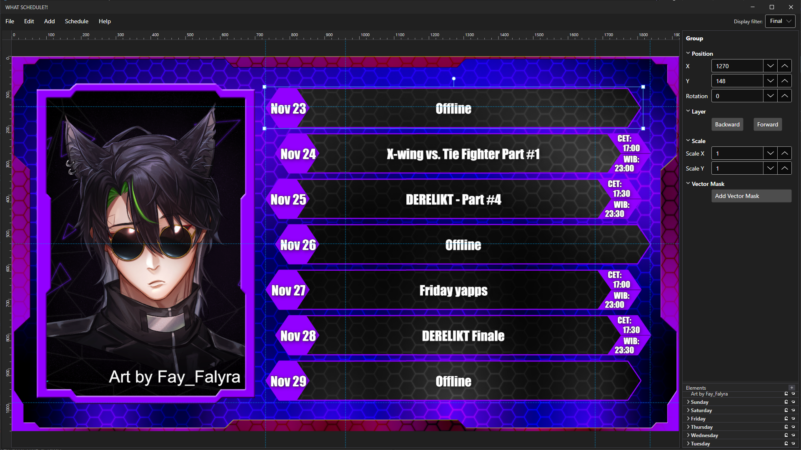

# WHAT SCHEDULE ?!
A free, multi-platform program for handling stream schedule and generating PNGs for them written in C#. This application uses [Avalonia UI](https://avaloniaui.net/), with image processing handled by [SkiaSharp](https://github.com/mono/SkiaSharp).

This application targets Windows and Linux.

## AI disclosure
While this project isn't entirely vibe coded, it is only right to be transparent that AI was used in development of this project. Many developers nowadays try to hide it and while there is still some projects written by hand, it's very safe to assume that overwhelming majority of projects that appear out of nowhere were written by AI and just don't disclose it.

The core of this project was written with help of small GLM 5.3. It's a combination of human written classes, human made assets generated code. You can read more about [AI POLICY](AI_POLICY.md) or [in this post](https://github.com/SuiMachine/WHAT-SCHEDULE/discussions/6).

# Features

- Variety of effects for modifying labels and images.
- Hierarchical object structure that supports item groups.
- Automatic timezone conversion.
- Import from PSD files (layers should have effects removed or rasterized before importing).
- Import of your stream schedule for the week from Twitch.
- Export of your weekly schedule to PNG.

## Prerequisites

- [.NET SDK 10.0](https://dotnet.microsoft.com/download/dotnet/10.0)

## Libraries used
- [Avalonia (UI)](https://github.com/avaloniaui/avalonia)
- [Avalonia Spell Checker](https://github.com/GustavoHennig/Avalonia.SpellChecker)
- [SkiaSharp](https://github.com/mono/skiasharp)

## References used
Simplified PSD importer was written based on:
- [Adobe Photoshop File Formats Specification](https://www.adobe.com/devnet-apps/photoshop/fileformatashtml/) - the format the importer reads.
- [ag-psd](https://github.com/Agamnentzar/ag-psd)
No direct code was used from either, but both helped to build a simplified importer.
